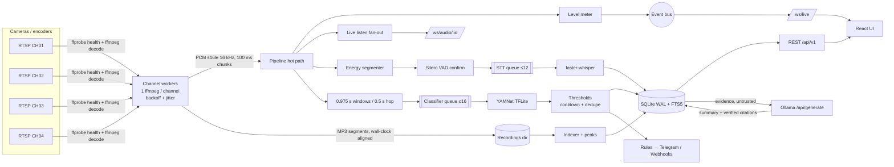

# Architecture

EchoSentinel is a single-node service: one Python process (FastAPI + asyncio) supervises one FFmpeg process per audio channel and serves a static React UI. Everything (audio, transcripts, models, analysis) stays on the host.

## Data flow



## Why these choices

| Decision | Reason |
|---|---|
| **One FFmpeg per channel, two outputs** | Decode once; PCM for analysis and MP3 segments for recording come from the same timeline. Workers are isolated — one bad camera never affects another. |
| **MP3 segments** | Crash-safe (no trailing index like MP4), seekable with HTTP Range, plays in every browser. `-segment_atclocktime` aligns files to wall-clock hours; filenames carry UTC start time so the index can be rebuilt from disk at any time. |
| **SQLite (WAL) + FTS5** | Four channels on one host doesn't justify running PostgreSQL. WAL gives crash safety; FTS5 gives fast transcript search. Migrations are versioned SQL in `backend/echosentinel/migrations/`. |
| **PCM over WebSocket for live listening** | ~100–300 ms latency, no extra encoder process, works behind any reverse proxy that passes WebSockets, and the browser never sees the RTSP URL. Trade-off: ~256 kbit/s per listener (fine on LAN/tailnet). |
| **Two-stage VAD** | A cheap adaptive energy gate runs on every chunk; Silero (bundled with faster-whisper) confirms speech before burning STT time — keeps traffic/wind noise from producing hallucinated text. |
| **YAMNet TFLite** | 521 AudioSet classes, ~4 MB, ~10–20 ms per window on CPU. Labels are mapped to 8 operator-facing categories with conservative per-category thresholds and cooldowns. |
| **Ollama for text only** | Summaries are built from stored transcripts and detections, never raw audio. Evidence is delimited and marked untrusted; citations to evidence that wasn't supplied are stripped. |
| **Bounded queues, drop-oldest** | If STT falls behind (slow CPU), the newest speech is kept and drops are counted and exposed (`/metrics`, System page) rather than memory growing without bound. |

## Components (backend/echosentinel)

| Module | Responsibility |
|---|---|
| `channels/worker.py` | FFmpeg supervision, state machine (`connecting → online → offline/error`), exponential backoff with jitter, stall watchdog, stderr redaction |
| `channels/probe.py` | ffprobe probing, protocol whitelist, error classification (auth / not found / refused / timeout / codec) |
| `audio/pipeline.py` | Hot path fan-out, queues, latency stats, event thresholds and duplicate suppression |
| `audio/vad.py`, `audio/stt.py`, `audio/classifier.py` | Segmentation, faster-whisper wrapper with hallucination filtering, YAMNet wrapper — each reports honest `state` |
| `recorder.py` | Segment indexing, per-second waveform peaks, retention + quota, disk-free guard, clip extraction, timeline assembly |
| `engine.py` | Composition root and background loops (metrics, Ollama health) |
| `notify.py` | Rules, quiet hours, Telegram, signed webhooks |
| `api/*` | REST + WebSocket endpoints, auth, RBAC, CSRF, audit |
| `demo.py` | Demo-mode synthetic transcripts/detections (isolated DB) |

## Time synchronisation

* PCM chunks are stamped with wall-clock time at receipt; segments derive start time from the same clock (`TZ=UTC` strftime filenames).
* `aresample=async=1000` absorbs camera clock drift and gaps.
* Documented tolerance: transcript/event ↔ recording alignment within **±1 s** (one chunk of decode latency plus FFmpeg buffering); timeline waveform resolution is 1 s.

## Storage layout

```
$ES_DATA_DIR/
  echosentinel.db          # metadata (demo.db in demo mode)
  models/yamnet.tflite     # classifier
  models/whisper/          # faster-whisper cache
  recordings/ch01/ch01_20261102T060000Z.mp3
```

Only files matching `chNN_YYYYMMDDTHHMMSSZ.mp3` inside the recordings root are ever indexed or deleted.

## Risk & rollback

* Installation never touches firewall rules, existing NVR services or their recording paths.
* Upgrades: stop service → `scripts/backup.sh` → install new version → start. Roll back by reinstalling the previous release and `scripts/restore.sh`.
* Schema migrations are forward-only and transactional; the pre-upgrade backup is the rollback point.
